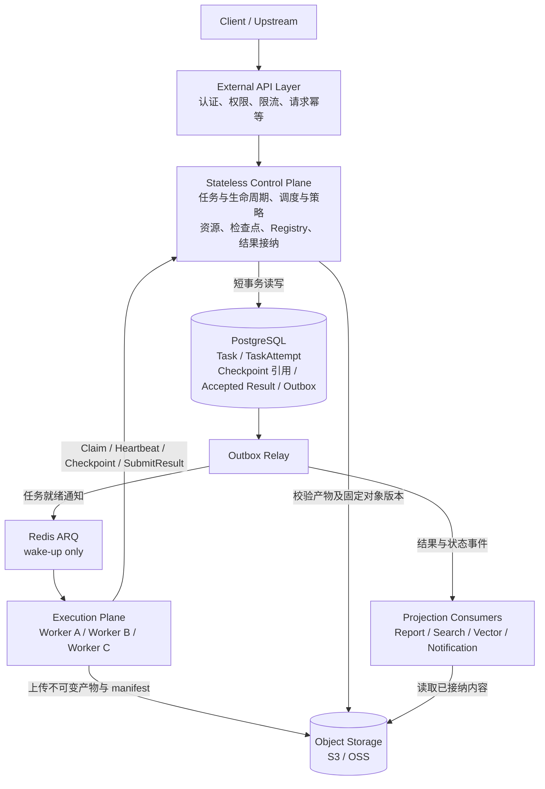
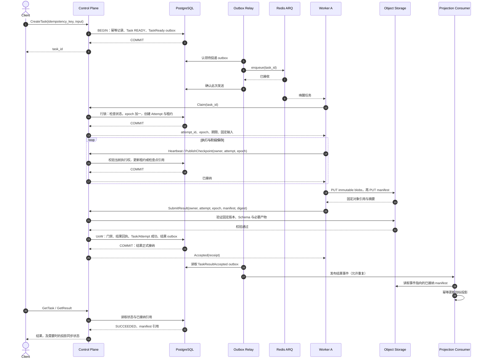
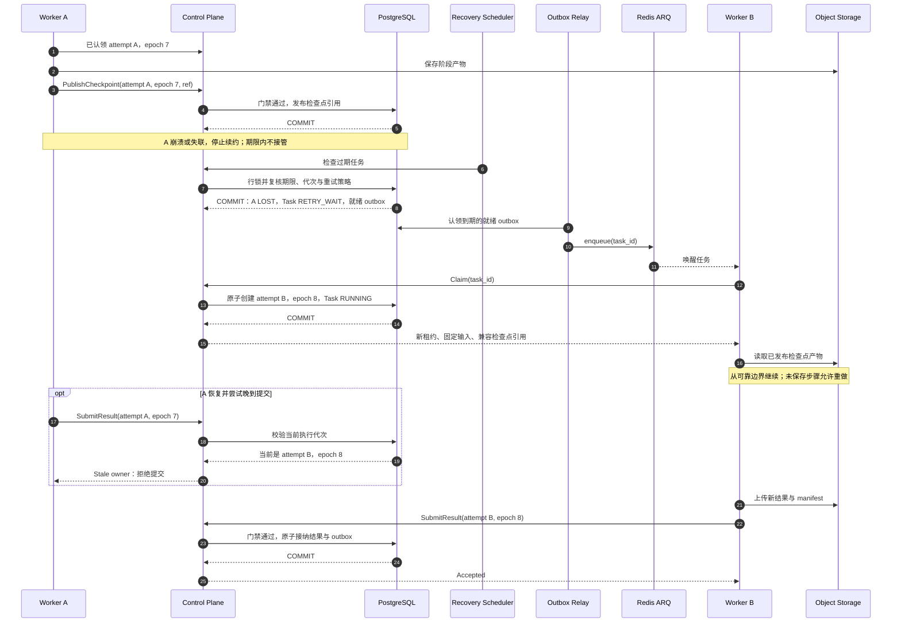
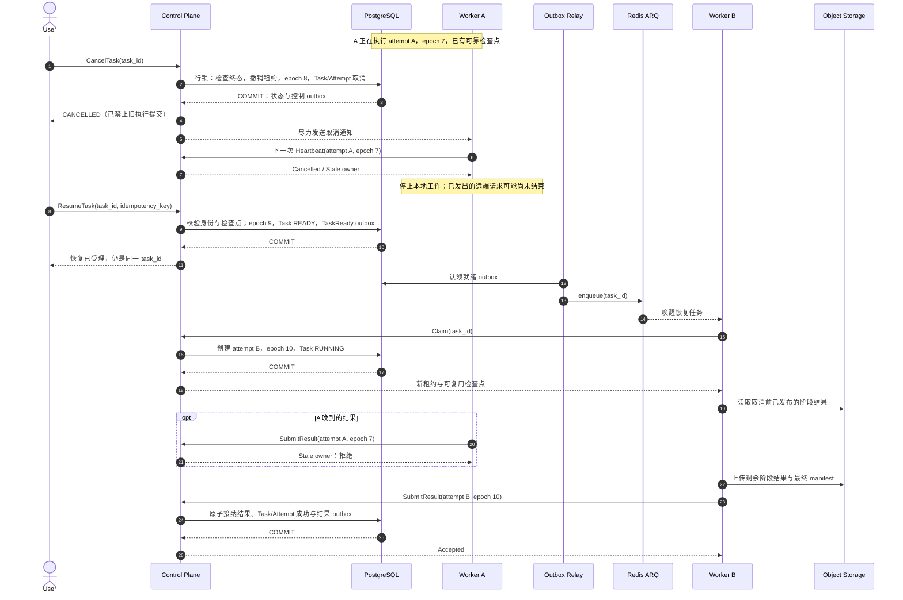

# 任务结果接纳与故障恢复

[返回架构总览](README.md)

一次审查可能运行几分钟，跨越数十轮模型和工具调用。Worker 算完了，不代表平台就应该接受它的结果：执行期间可能已经发生接管、取消或恢复，较晚返回的结果也可能来自已经失效的执行者。

本文描述控制平面与执行平面的目标协作架构，补全正常完成、故障接管和取消后恢复的生命周期。事务 outbox、对象存储与跨存储投影属于这里定义的设计，不表示当前代码已经全部实现。以下叙述按这套架构展开。

## 平台保存事实，队列负责唤醒

外部接入层处理认证、权限、限流和请求幂等。控制平面管理任务状态、执行策略、调度、租约与结果接纳；执行平面的 Worker 运行 Agent，读取代码、调用模型并生成产物。它们通过持久化任务身份与执行协议协作，不依赖某个 API 进程里的对象。



PostgreSQL 保存任务状态、执行代次、租约、检查点引用和已接纳结果，是执行与接纳事实的权威。对象存储保存不可变内容；数据库中的引用决定哪个版本是有效结果。Redis ARQ 中的消息只是“这个任务值得检查”的通知，Worker 收到后必须重新查询并认领，不能把消息到达当成所有权证明。

任务和就绪 outbox 在同一事务中创建。Relay 使用自己的短期认领机制并行处理 outbox，投递成功后才确认发送；网络等待不占用业务事务。如果投递成功但确认前崩溃，恢复后可能再次发送，数据库认领负责处理重复。

Outbox 解决的是“状态已提交，发布意图却丢失”的窗口，不是消息永不丢失的承诺。Relay 确认发送后 Redis 仍可能故障，因此控制平面也对到期仍未认领、处于重试等待以及租约过期的任务做对账补投。队列可以重建，任务事实不能只留在队列里。

## 一个 Task，可以有多次执行尝试

Task 表示一次逻辑审查，固定输入快照、审查配置与最终结果。TaskAttempt 表示一次实际执行。Worker 重启或任务恢复会产生新 Attempt，而不是让旧 Attempt 重新拥有权限。

认领时，控制平面锁住任务的执行记录，检查状态和租约，再递增 `lease_epoch`、创建 Attempt、分配 owner 与到期时间。事务提交后 Worker 才能开始执行。行锁只用于这些短事务，不覆盖整个审查过程。

每次心跳、检查点发布和最终提交都携带任务、Attempt、Worker 与 epoch。控制平面使用数据库时间检查期限，统一以 `db_now < lease_expires_at` 判定尚未过期，过期租约不能通过一次晚到的心跳复活。epoch 只能向前推进，不能回退或复用。

这套机制保证受管写入只有一个有效提交者。旧 Worker 可能仍在运行，已经发出的模型请求也可能继续计费；fencing 拒绝它的写入，不承诺撤销所有外部动作。因此执行阶段默认只读，GitHub 评论、通知等副作用应通过接纳后的专用发布流程执行。

## 结果上传与结果接纳是两件事

Worker 先上传结果 blob，再上传列出所有必要产物的 manifest。对象使用 Attempt 和 epoch 命名空间，固定对象版本或内容寻址，并以禁止覆盖的写入策略保存。路径里带 epoch 只用于隔离，不能单独证明对象不可变。

manifest 说明任务与尝试身份、输出 Schema、产物引用、长度和内容摘要。它上传完成时仍只是候选结果，不能因为文件存在就把任务展示成成功。

Worker 随后发送 `SubmitResult(task_id, attempt_id, worker_id, lease_epoch, manifest_uri, manifest_digest)`。控制平面验证访问权限、存储来源、manifest 摘要、Schema 和必要产物完整性，并核对其中的执行身份、输入快照与配置指纹是否属于当前任务。对象读取和较重的内容校验放在事务外；校验绑定不可变对象版本，不能在检查后被换成另一份内容。Worker 提交任意 URL 也不意味着控制平面应替它发起网络访问。

真正的提交点是 Result Acceptance 的一个短数据库事务：

```text
UnitOfWork
  ├─ 锁住任务执行记录，读取当前状态
  ├─ 检查未取消、owner、attempt、epoch 与租约期限
  ├─ 确认已验证 manifest 仍可发布，且未被回收
  ├─ 保存唯一的已接纳结果与接纳回执
  ├─ TaskAttempt → SUCCEEDED，Task → SUCCEEDED
  ├─ 更新同库的最终阶段、Finding 与结果引用
  └─ INSERT outbox(TaskResultAccepted)
COMMIT
```

同库写入由 UnitOfWork 统一提交，参与者不能各自 commit。任何校验或数据库写入失败，都不能留下“Finding 已落库，任务却未成功”或“任务成功，结果事件没有发布意图”的半成品。

这里不把对象存储、Redis 或模型调用拉进数据库事务。事务失败可能留下未被引用的候选文件，但不会让它成为有效结果。数据库门禁在持锁时校验租约，接管与取消也必须取得同一把锁，所以它们不会穿过“门禁已通过、尚未提交”的窗口。这个顺序保证不等于严格承诺数据库 commit 的墙钟时刻必然早于租约截止，接纳事务仍应尽量短。

## 正常执行：从请求到可读取的结果

接入层以项目、调用方和操作为作用域处理 `idempotency_key`，并保存请求内容指纹。同一键、同一输入返回原 task_id；同一键换了输入则拒绝，不把另一次审查误当重试。创建 Task 和 `TaskReady` outbox 一起提交，即使 API 在响应前退出，调用方也能安全重发。

Relay 将 task_id 投递到 ARQ。Worker 收到通知后调用 Claim；只有当前可执行的任务才会授予新 Attempt 与租约。任务已成功或取消、尚未到重试时间，或已有有效 owner，均不能直接开跑。重复通知可以被忽略或退避，不改变正在运行的 Attempt。

执行过程中，Worker 定期续约，并在稳定阶段发布检查点。计算完成后上传产物与 manifest，通过 Result Acceptance 接纳。主结果接口此时即可根据数据库中的已接纳引用读取内容，不必等待搜索或向量投影完成。



### 提交超时，不等于提交失败

如果接纳事务已经提交，但 Worker 没收到响应，它应重发相同提交，而不是创建另一份结果。幂等接纳的键绑定 task、attempt 和 epoch，回执绑定 manifest 摘要。

控制平面先在授权范围内查找已提交回执：同一键、相同摘要返回原回执，即使原租约此时已经结束；同一键提交不同摘要则冲突。没有回执才进入新结果的所有权门禁。不能把普通的 `Task.status == SUCCEEDED` 当成这次提交已成功，否则另一个 owner 的结果也可能被误认领。

事务提交结果不明时，以数据库回执判定，不靠 Worker 本地异常猜测。成功结果不允许通过 Resume 原地覆盖；重新审查应创建新 Task。

## Worker 中途失败：重新拉起不等于延续旧执行权

假设 Worker A 持有 epoch 7，完成了结构分析并发布检查点，随后进程退出。它无法发送最后一次心跳，任务在租约到期前仍有 owner；平台不会仅因一条网络超时就立即让另一 Worker 并行接管。

租约到期后，恢复调度器重新检查任务。若符合重试策略，它在事务中将旧 Attempt 记为 LOST，清理失效租约，将 Task 放入 `RETRY_WAIT` 并写入下一次可执行的就绪 outbox；重试次数、退避和总 deadline 一并检查。过期状态转换必须带当前 Attempt 与 epoch 条件，不能由一次陈旧扫描清掉刚续约的 owner。

Worker B 收到新的唤醒消息后认领，取得新的 Attempt 和 epoch 8。它只加载控制平面已发布且与固定输入、配置、Schema 兼容的检查点，复用已完成阶段；尚未可靠保存的模型调用和工具步骤可能重做。即使重新拉起的仍是 A 所在机器，也必须重新认领。

旧 A 如果恢复并晚到续约或提交，都会因为 owner、Attempt 或 epoch 不匹配被拒绝。它上传的文件仍是候选，不能覆盖 B 的结果。



如果 Worker 仍能响应并报告可重试错误，可以主动上报失败，由控制平面关闭本次 Attempt、失效执行权并安排重试，不必等租约耗尽。不可重试错误、重试耗尽或全局期限到达则进入 FAILED，不无限补投。`TIMED_OUT`、`LOST` 描述 Attempt 的结束原因，不要求每一次执行失败都立即把逻辑 Task 判为最终失败。

自动恢复依赖过期扫描、重试记录与补投共同推进。单独拥有一个会过期的 lease，不能保证任务一定会再次运行。

## 用户中途取消，再 Resume 恢复

取消先改变提交权限，再尽力停止计算。控制平面锁住同一任务执行记录，将当前 Attempt 标记取消、Task 切为 CANCELLED、撤销 owner 并推进 epoch，同时写入状态事件与控制通知。事务提交后，旧 Attempt 就无权续约、发布检查点或接纳结果，不需要等待 Worker 确认才生效。

Worker 收到取消通知，或在下一次心跳发现失效后，协作退出并清理本地资源。API 返回 CANCELLED 表示平台已禁止旧执行继续提交，不代表远端模型请求已经物理停止，也不保证请求不会继续计费。

取消与完成争抢同一条执行记录。完成接纳先提交，任务保持 SUCCEEDED，取消不能覆盖成功；取消先提交，随后到达的完成请求被拒绝。正在进行的提交若持锁，取消等待锁释放，按事务顺序得到明确结果。

Resume 是显式的重新执行命令。它检查用户权限、任务状态、固定输入与配置兼容性，确认可以复用哪些检查点，再将 Task 切回 READY、清除取消标记并写入新的 `TaskReady` outbox。Resume 自身也要幂等，重复点击不能反复推进代次、撤销刚恢复的新 owner。

恢复保留 task_id、固定输入及历史 Attempt，创建新 Attempt。取消时已推进过 epoch，Resume 可以再推进一次以撤销残余执行权，下一次 Claim 继续递增；epoch 不要求连续，要求严格不复用。改了源码、模型策略或影响结果的配置，应创建新 Task，而不是借 Resume 混用旧检查点。



恢复使用取消前已经通过门禁发布的检查点，不因为其 epoch 较旧就一律丢弃。需要判断的是检查点是否属于同一逻辑任务、输入和兼容版本，且引用内容完整可信。取消后旧 Worker 自行留下的文件没有发布资格，不能被 Resume 扫目录捡回来当作检查点。

如果某个 Agent 尚未形成可靠检查点，Resume 会重做这一段。这里承诺从已保存边界继续，不承诺还原任意协程栈、重建模型隐藏思考或让每一次供应商请求恰好发生一次。

## 接纳以后，跨存储如何保持一致

已接纳结果与 `TaskResultAccepted` outbox 在同一数据库事务产生。消费者读取事件中的任务身份、结果版本和 manifest 摘要，再读取相应内容更新报告库、搜索索引或向量库。主结果接口读的是权威接纳引用，搜索暂时不可见不能把已经成功的任务改回失败。

`event_id` 识别同一条事件的重复投递，`task_version` 识别同任务状态变更的先后，manifest 摘要绑定具体内容，它们不能互相替代。重复发布必须沿用原 event_id，不能每次重试都生成新事件。较旧版本晚到时不能覆盖较新投影，也不能仅凭一个较新状态事件就跳过尚未处理的结果内容。

目标投影与消费去重记录在同一数据库时，可以共事务更新。如果目标是 Elasticsearch 或其他外部存储，不能先在本地标记“已处理”，再假设外部写一定成功；应先用确定性文档键、结果版本或目标存储支持的条件写使更新可重试，再确认消费。外部更新后确认前崩溃，重放仍应得到同一投影。

多文档报告或向量分片可以按 manifest 版本构建，完整写好后再切换已发布版本。更新中的半份投影不应冒充完整结果。通知、扣费等副作用也不能只靠一句“幂等投影”：目标服务支持幂等键时使用该能力，否则必须明确重复与漏发之间的取舍。

消费者暂时失败不会回滚已经接纳的审查结果。系统保留待消费记录，重试并监控积压，长期失败进入人工可处理的异常队列；保留事件与 manifest，使目标存储可以重建。最终一致要求恢复和对账机制持续工作，不是 outbox 表存在就自然完成。

## 候选产物的回收不能与发布竞争

失效 Worker、失败提交和取消都会留下候选产物。回收应覆盖 blob 与 manifest，检查已接纳结果、有效检查点和正在接纳的发布保留记录，而不是仅凭创建时间超过 N 天就删除。

对象校验到事务接纳之间需要有明确的发布保留期或受控的保留记录，避免 GC 在结果验证后把对象删掉。回收先在元数据中确认无引用、无有效保留并标记待删除，新的发布门禁拒绝引用这些对象，再异步删除内容。发布与回收争用的状态必须由同一权威协调；扫描两遍对象目录并不能消除竞争。

已经接纳的内容按数据保留策略回收，不作为普通孤儿处理；删除对象也不等于抹掉接纳回执与审计记录。若允许结果过期，查询接口应明确返回内容已过期，而不是将它解释为从未成功。

## 三条生命周期共用的边界

| 情况 | 平台处理 | 不应该发生的事 |
| --- | --- | --- |
| 同一创建请求重复提交 | 同输入返回原任务，不同输入报幂等冲突 | 新建多个逻辑任务或悄悄替换输入 |
| 队列重复通知 | 重新检查事实，有效 owner 未失效则不认领 | 因拿到消息就直接开始执行 |
| Worker 失联 | 租约到期后按重试策略补投，新 Attempt 取得新 epoch | 让旧 epoch 通过晚到心跳复活 |
| 最终接纳事务失败 | 同库变更回滚，候选对象等待回收 | 阶段、Finding 与任务终态部分成功 |
| 提交响应丢失 | 相同提交查询并返回原接纳回执 | 因租约结束否定已接纳结果，或重复生成结果事件 |
| 取消与完成并发 | 由同一门禁记录的事务顺序决定胜者 | 取消后旧 Attempt 继续完成，或成功被取消覆盖 |
| 取消后恢复 | 校验固定输入，复用合法检查点，新 Attempt 执行 | 将旧 Worker 未发布文件误认成检查点 |
| 投影重复或乱序 | 按稳定事件身份与结果版本幂等处理 | 较旧结果覆盖新版本或确认后丢外部写 |

平台把计算是否继续运行、结果是否有权提交、投影是否同步完成分开处理。这样，接管不必等待旧进程自觉退出，取消可以先阻止旧结果写入，恢复也能在保留可靠阶段结果的同时取得新的执行权。
