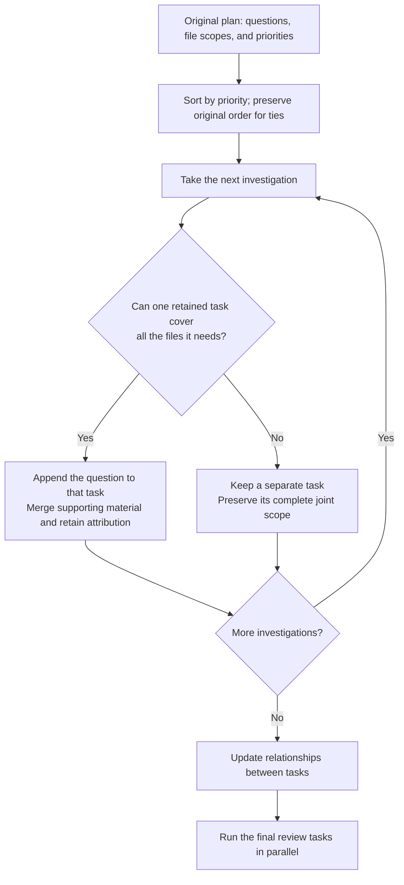

# Priority-Aware Cohesive Investigation Preservation

[中文](cohesive-investigation-repair.md) · [Architecture overview](README.en.md)

A code review may involve several files and several questions about the same file. The system creates an investigation plan, then assigns its work to parallel review tasks. The challenge is **to reduce redundant task launches while preserving every question and the files that must be examined together**.

We call this plan-processing step repair. The same abstract example below shows the old and new algorithms' results. No knowledge of the project's code is needed.

## One plan, four files, seven investigations

Let **F1–F4** denote four changed files, **Q1–Q7** seven investigation questions, and **T1–T7** the seven tasks in the original plan. A Q can contain related subquestions; it is not an already-discovered defect. For example, Q2 might ask whether exceptional inputs are handled correctly, while Q3 asks whether two files agree on a calling contract.

Each question has files that must be examined together. `Q3 → {F1,F2}` means F1 and F2 must be considered in the same investigation. Assigning only one of them does not fully assign Q3.

The following example preserves the file sets, task order, and priorities of an actual plan, replacing domain names with symbols. Lower numbers indicate higher investigation priority.

| Original order | Question | Files to examine together | Priority |
|---|---|---|---:|
| T1 | Q1 | F1 | 1 |
| T2 | Q2 | F1 | 3 |
| T3 | Q3 | F1, F2 | 2 |
| T4 | Q4 | F1, F2 | 4 |
| T5 | Q5 | F1, F2, F3, F4 | 6 |
| T6 | Q6 | F1, F4 | 5 |
| T7 | Q7 | F1, F2 | 7 |

Direct execution would launch seven review tasks. Some files would be read repeatedly, but the questions differ. Optimizing assignments needs to preserve those distinct questions.

## The old algorithm covered the files but lost questions

The old algorithm required each file to belong to only one task and processed tasks in their original order. It removed previously assigned files from later tasks, then deleted a task if no files remained.

T1 receives F1 first. T2 also needs only F1, so it is deleted and Q2 disappears. When T3 is processed, F1 is already assigned and only F2 remains. Q3 survives as text, but its joint scope is reduced. Continuing produces this result:

| Original task | Files assigned by the old algorithm | Effect on the question |
|---|---|---|
| T1 | F1 | Q1 is retained. |
| T2 | None; task deleted | Q2 is lost. |
| T3 | F2 | Q3 survives, but F1 is removed from its required joint scope. |
| T4 | None; task deleted | Q4 is lost. |
| T5 | F3, F4 | Q5 survives, but F1 and F2 are removed from its required joint scope. |
| T6 | None; task deleted | Q6 is lost. |
| T7 | None; task deleted | Q7 is lost. |

Three tasks remain, and every file from F1 to F4 is assigned, so the file-coverage check passes. Yet only three of seven question entries survive, and two have reduced scopes. **Reviewing a file does not mean that every question about it has been preserved.**

One task examining F1 and another examining F2 does not establish that anyone checks their calling contract. A cross-file question needs a task explicitly responsible for the joint investigation.

## The new algorithm merges only into tasks that can take the whole question

The new algorithm sorts by priority, retaining original order for ties. In this example, the processing order becomes T1, T3, T2, T4, T6, T5, T7.

For each task, it asks whether **one retained task already contains every file it needs**. If so, the question is assigned to that task. Otherwise, the task keeps its full scope, even when some files overlap with other tasks. If several retained tasks qualify, the earliest in priority order receives the question.

Q2 from T2 can therefore go to T1: both need only F1. Questions from T4 and T7 can go to T3, which already examines F1 and F2 together. T6 needs F1 and F4, and no retained task covers both, so it stays. T5 needs all four files and also remains independent.

| Final task | Files examined together | Questions received | Change from the original plan |
|---|---|---|---|
| T1 | F1 | Q1, Q2 | Absorbs T2's question; no separate T2 launch. |
| T3 | F1, F2 | Q3, Q4, Q7 | Absorbs T4 and T7's questions; no separate launches. |
| T6 | F1, F4 | Q6 | Keeps its complete cross-file scope. |
| T5 | F1, F2, F3, F4 | Q5 | Keeps its complete cross-file scope. |

Four tasks now carry all seven investigations. Each question still belongs to a task with its full target scope.

Full-containment merging is directional. If `{F1,F2}` comes first and `{F1}` later, the latter can be merged into the former. If `{F1}` comes first and `{F1,F2}` later, both remain. Higher-priority tasks are not absorbed backward into later, larger tasks. Even if separate `{F1}` and `{F2}` tasks exist, a new `{F1,F2}` investigation stays: no single retained task can take it whole.

Merged questions remain separate entries with their original attribution and rationale. The reviewer receives a numbered list, avoiding detail loss through summarization. The receiving task keeps its priority, and supporting material is combined and deduplicated. One task can investigate several questions without launching a separate reviewer for each one.

## Relationships still work after tasks merge

A plan may also ask for the results of two investigations to be checked together. For example, does the exceptional-input rule examined by Q2 agree with the calling contract examined by Q3? Task merging must not leave that relationship without valid endpoints.

Consider an illustrative relationship between T2 and T3. When T2 merges into T1, the system records `T2 → T1` and updates the relationship to connect T1 and T3. Q2 remains Q2, and the later comparison still identifies the intended investigations.

| Original relationship | Task merge | What happens to the relationship |
|---|---|---|
| Compare T2 with T3 | T2 merges into T1 | Compare T1 with T3, preserving the relationship description. |
| Compare T4 with T7 | Both merge into T3 | Turn it into an internal comparison question for T3. |

Final tasks keep stable names, while mappings preserve original attribution. Names do not need to be concatenated into long labels. If ambiguous names, splitting, or deferral prevent a direct mapping, the system records the unresolved work instead of treating it as completed.

## Same-case comparison: fewer tasks with investigations preserved

The task sets above come from an actual execution record. On 2026-10-15, we extracted the same original plan, replayed it offline through the new algorithm, and compared the result with the saved old output. The replay neither regenerated the plan nor called a model, keeping the questions and file scopes fixed.

| Approach | Review tasks | Original investigation entries retained | Cross-task relationships retained |
|---|---:|---:|---:|
| Execute each original task separately | 7 planned | 7 | 4 |
| Old algorithm: assign each file once | 3 | 3, with two scopes reduced | 1 |
| New algorithm: containment, overlap preservation, and remapping | 4 | 7, with complete scopes | 4 |

Compared with launching each original task separately, the new algorithm reduces the count from 7 to 4, a **42.8% reduction**, while retaining all seven investigations and four relationships. The calculation is `(7−4)/7`, or exactly 42.857…%. The 42.8% figure truncates to one decimal place; conventional rounding gives 42.9%. Relative to the old algorithm, the new one retains an additional task to recover investigations that were incorrectly deleted or fragmented.

Three other saved real-model runs completed all their review tasks, with counts of 4, 4, and 8 and no failed or deferred tasks. They show that repaired plans can execute in practice. Because those plans were regenerated by a model, they do not isolate repair's causal benefit. The 42.8% result describes the small, same-case comparison above, not an average over all changes, and cannot directly be converted into a cost or latency reduction.

The algorithm preserves investigation assignments; it does not ensure that reviewers discover defects. It allows repeated file reads for distinct cross-file questions and does not seek the absolute minimum task count. Execution is subject to capacity limits: oversized tasks may be split and investigations beyond the task-count limit may be deferred. Such cases must be recorded rather than described as complete execution of every investigation scope.

Supporting design and item-level experimental analysis are available in the [design record](../docs/spec/25.5A-PlanRepair内聚维度与Reviewer输入.md) and [experiment quality review](../docs/analysis/25.5B-三例Review质量基线.md).
