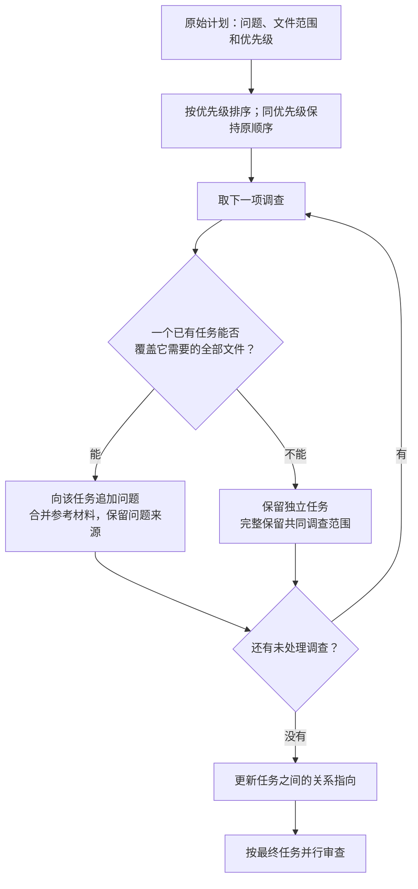

# 优先级感知的内聚调查保全算法

[English](cohesive-investigation-repair.en.md) · [架构概览](README.md)

一次代码审查可能涉及多个文件，也可能需要从不同角度检查同一个文件。
我们希望系统先生成调查计划，再交给多个审查任务并行执行。这里需要解决的问题是：**怎样减少重复启动的任务，同时不丢掉调查问题，也不拆散必须一起检查的文件（跨文件风险）？ 同时保证每个文件都至少分配一个审查任务确保文件全部被检查**

我们把计划整理过程称为 **优先级感知的内聚调查保全算法**。下面用同一个抽象例子展示我们实现的**错误算法**和**更加优秀的优先级感知的内聚调查保全算法**的结果，理解它不需要了解项目代码。

## 一份计划，五个文件，七项调查

用 **F1～F5** 表示五个变更文件，**Q1～Q7** 表示七项待验证的调查问题，**T1～T7** 表示原计划中的七个任务。一个 Q 可以包含若干相关子问题，并不代表已经发现一个缺陷。例如，Q2 可以询问“异常输入是否被正确处理”；Q3 可以询问“两个文件之间的调用约定是否一致”。

每个问题都有需要共同检查的文件。`Q3 → {F1,F2}` 表示必须把 F1、F2 放在同一次调查中判断；只分配其中一个文件，不能认为 Q3 已得到完整安排。

下表保留了一个实际计划的文件集合、任务顺序和优先级，只将业务名称替换为符号。数字越小，调查优先级越高。

| 原计划顺序 | 调查问题 | 需要共同检查的文件 | 优先级 |
|---|---|---|---:|
| T1 | Q1 | F1 | 1 |
| T2 | Q2 | F1 | 3 |
| T3 | Q3 | F1、F2 | 2 |
| T4 | Q4 | F1、F2 | 4 |
| T5 | Q5 | F1、F2、F3、F4 | 6 |
| T6 | Q6 | F1、F4 | 5 |
| T7 | Q7 | F1、F2 | 7 |

F5 被大模型没有正确的分组返回， 遗失

直接执行需要启动七个审查任务。它们会重复读取一些文件，但调查问题并不相同。优化任务安排时，需要保留这些不同的问题。

## 原算法：同一个文件只能最多被一个任务所拥有， 遗失的文件自己一个调查任务

原算法要求“一个文件只能分给一个任务”，按原计划顺序处理。后来的任务遇到已分配文件，就删掉这个文件；如果没有剩余文件，整个任务也被删除。 

T1 首先拿到 F1。T2 也只需要 F1，于是它被删除，Q2 随之丢失。轮到 T3，F1 已经分配，只剩 F2：Q3 虽然还在，但它需要的联合调查范围被缩小了。继续处理后，结果如下。

| 原任务 | 原算法分配的文件 | 对调查问题的影响 |
|---|---|---|
| T1 | F1 | 保留 Q1。 |
| T2 | 无，删除任务 | 丢失 Q2。 |
| T3 | F2 | 保留 Q3 文本，但移除了需要共同检查的 F1。 |
| T4 | 无，删除任务 | 丢失 Q4。 |
| T5 | F3、F4 | 保留 Q5 文本，但移除了需要共同检查的 F1、F2。 |
| T6 | 无，删除任务 | 丢失 Q6。 |
| T7 | 无，删除任务 | 丢失 Q7。 |

最后只剩三个任务，F1～F4 都有人审查，所以“文件覆盖完整”的检查仍然通过。然而，七项调查只剩三项文本，其中两项的范围还被削减了。**文件被检查过，不等于关于这个文件的所有问题都得到了保留。**

一个任务检查 F1，另一个检查 F2，也不意味着有人验证了两者的调用约定。跨文件问题需要一个明确负责联合判断的任务。

## 新算法：只合并能够完整接住问题的任务

新算法先按优先级排序，同优先级保持原计划顺序。本例处理次序变为 T1、T3、T2、T4、T6、T5、T7。

处理一个任务时，检查是否存在**一个已经保留的任务，包含它需要的全部文件**。如果存在，就把问题交给它；如果不存在，就保留原任务的完整范围，即使其中有文件与别的任务重叠。多个已有任务都能完整接收时，选择优先顺序最靠前的一个。

因此，T2 的 Q2 可以交给 T1：两者都只需要 F1。T4 和 T7 的问题可以交给 T3：T3 已经共同检查 F1、F2。T6 需要 F1、F4，此时没有一个已有任务能完整接收，所以继续保留。T5 需要全部四个文件，也保持独立。

| 最终任务 | 共同检查的文件 | 收到的调查问题 | 相对原计划的变化 |
|---|---|---|---|
| T1 | F1 | Q1、Q2 | 吸收 T2 的问题，不再单独启动 T2。 |
| T3 | F1、F2 | Q3、Q4、Q7 | 吸收 T4、T7 的问题，不再单独启动它们。 |
| T6 | F1、F4 | Q6 | 保留完整跨文件范围。 |
| T5 | F1、F2、F3、F4 | Q5 | 保留完整跨文件范围。 |

结果是四个任务接住全部七项调查。每个问题仍然交给一个拥有其完整目标范围的任务。

“完整包含合并”是单向的。先有 `{F1,F2}`，后有 `{F1}`，后者可以并入前者；先有 `{F1}`，后有 `{F1,F2}`，则保留两个任务。高优先级任务不会被反向吸收到后来的大任务中。即使已经有 `{F1}` 和 `{F2}` 两个独立任务，新的 `{F1,F2}` 联合调查仍然保留，因为没有任何一个已有任务能单独承担它。

合并的问题仍作为独立条目保存，带着原来的来源和理由。审查者收到编号问题列表，避免重新概括时丢失细节。接收任务保持自己的优先级，参考材料合并去重。同一个任务可以验证多个问题，不需要为每个问题再次启动审查者。

## 任务合并以后，关系如何继续成立

计划还可能要求把两项调查的结论放在一起核对。例如，“Q2 检查的异常输入规则，是否与 Q3 检查的调用约定一致”。这类关系不能因为任务合并而失去指向。

以一条示意关系为例，它原本连接 T2 和 T3。T2 合并到 T1 后，系统记录 `T2 → T1`，再把关系更新为连接 T1 和 T3。Q2 本身仍叫 Q2，后续核对者也知道需要比较哪两项调查。

| 原关系 | 任务合并 | 关系的后续安排 |
|---|---|---|
| T2 与 T3 需要对照 | T2 合入 T1 | 改为 T1 与 T3 对照，关系说明保持不变。 |
| T4 与 T7 需要对照 | 两者都合入 T3 | 转成 T3 内部的一项核对问题。 |

最终任务保留稳定名称，原任务通过映射追溯，不必把多个名称拼成长名称。若名称有歧义，或任务被拆分、延期，导致关系不能直接映射，系统保留未解决记录，避免把尚未安排好的核对工作当成已完成。

## 同案例对照：减少任务，同时保留调查

上面的任务集合来自实际运行记录。2026-10-15，我们提取同一份原始计划，用新算法离线重放，并与保存的旧算法结果对照。重放不重新生成计划，也不新增模型调用，所以文件范围和调查问题保持一致。

| 比较方案 | 审查任务数 | 保留的原始调查条目 | 保留的跨任务关系 |
|---|---:|---:|---:|
| 原始计划逐项执行 | 7（计划值） | 7 | 4 |
| 原算法：每个文件只分配一次 | 3 | 3，其中两项范围被削减 | 1 |
| 新算法：包含合并、重叠保留、关系重映射 | 4 | 7，范围完整 | 4 |

相对原始计划逐项启动任务，新算法把任务数从 7 降到 4，减少 **42.8%**，同时保留七项调查和四条关系。计算式为 `(7−4)/7`，精确值为 42.857…%；42.8% 使用截断一位小数的口径，四舍五入则为 42.9%。相对旧算法，新算法多保留一个任务，恢复被错误删除或拆散的调查。

另有三个已保存的真实模型运行完成全部审查任务，任务数分别为 4、4、8，没有失败或延期任务。它们说明整理后的计划可以实际执行；由于计划由模型重新生成，不能用来单独测量 repair 的因果收益。42.8% 是上述小样本同案例的任务数结果，不代表所有变更的平均降幅，也不能直接换算为费用或耗时下降。

算法保证调查工作的传递，不保证审查者一定找到缺陷。它允许为独立的跨文件问题重复读取文件，也不追求绝对最少的任务数。实际执行还受容量限制：过大任务可能拆分，超出任务数量上限的调查可能延期；这些情况需要明确记录，不能继续宣称所有调查范围都完整执行。

设计依据与逐条实验复核见[设计记录](../docs/spec/25.5A-PlanRepair内聚维度与Reviewer输入.md)和[实验质量复核](../docs/analysis/25.5B-三例Review质量基线.md)。
